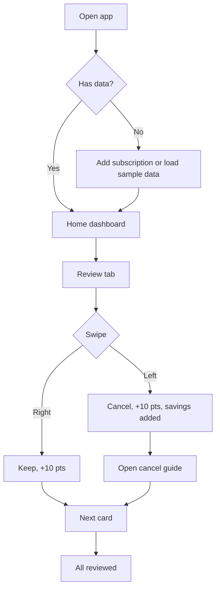

# 01 - Features, persona and design system

## Problem
People forget subscriptions and keep paying for ones they no longer use.
**HMW:** How might we help people notice subscriptions they've stopped using, and make it easy to act before the next charge?

## Primary persona: Aanya, 19, college student
Netflix, Spotify, Canva, free trials. Tight budget, forgets trials, ignores small charges. Wants to stop wasting pocket money.
Secondary: Rohan, 28 (working adult, many auto-pays) and Meera, 35 (freelancer, software tools).

## Features
Dashboard (monthly/yearly spend, renewals in 7 days, unused list) | Add subscription | Swipe review (keep/cancel) | Cancel guide link | Savings counter | Points and levels | Sample data.

## Colours
| Name | Hex | Use |
|---|---|---|
| Ink | #1D1B3A | Text, points badge |
| Paper | #F7F6FB | Page background |
| Violet | #5B4CDB | Brand, primary buttons |
| Mint | #17B890 | Keep, savings |
| Coral | #F2545B | Cancel, idle warnings |
| Amber | #FFB020 | Focus outline |

Text on paper and white passes WCAG AA contrast.

## Typography
- **Sora** (600/700): logo, headings, big numbers
- **Nunito Sans** (400/600): body, buttons, labels
- Scale: 38 / 32 / 26 / 22 / 18 / 16 / 14 px. Sentence case everywhere.

## User flow

